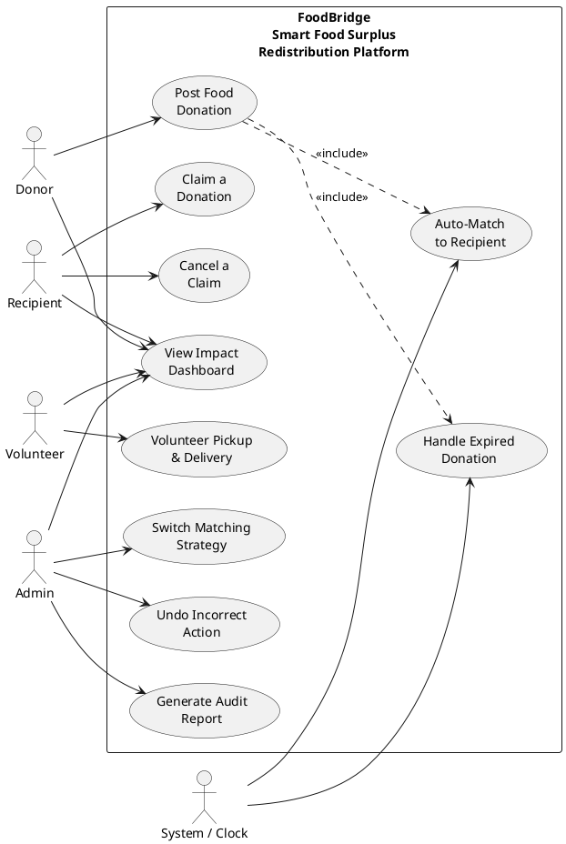

# Modeling Guide — FoodBridge Use Case Diagram

## Overview

This guide provides the specification for drawing a **UML Use Case Diagram** for the FoodBridge Smart Food Surplus Redistribution Platform. The diagram visually captures all functional requirements (use cases), the actors who interact with them, and the system boundary that defines the scope of the software.

---

## a. System Boundary (Overall Scope)

Draw a **rectangle** (the system boundary box) labeled:

```
FoodBridge — Smart Food Surplus Redistribution Platform
```

Everything inside this rectangle represents software functionality. All actors (stick figures) are placed **outside** the rectangle. All use cases (ovals) are placed **inside** the rectangle.

The scope of the system includes:
- Donation posting, verification, and lifecycle management
- Recipient claiming and cancellation
- Volunteer pickup and delivery workflows
- Smart auto-matching with swappable algorithms
- Real-time impact dashboard
- Expiry monitoring and auto-handling
- Admin controls: strategy switching, undo, audit reporting

---

## b. Actors

Place the following **4 primary actors** outside the system boundary box, connected to their use cases via solid lines (association relationships).

| Actor | Description | Notation |
|---|---|---|
| **Donor** | Restaurants, hotels, grocery stores, or individuals who post surplus food | Stick figure + label "Donor" |
| **Recipient** | NGOs, food banks, shelters, orphanages who claim donations | Stick figure + label "Recipient" |
| **Volunteer** | Logistics volunteers who pick up and deliver donations | Stick figure + label "Volunteer" |
| **Admin** | Platform administrator who manages strategies, undo, and audit reports | Stick figure + label "Admin" |

Additionally, include **1 secondary actor**:

| Actor | Description | Notation |
|---|---|---|
| **System** (or **Time**) | Represents automatic time-triggered behavior (auto-matching, expiry handling) | Stick figure + label "System" or "Clock" |

---

## c. Use Cases

Draw the following **10 use case ovals** inside the system boundary. Each oval contains the UC name. Group/arrange them logically by actor association.

### Use Cases by Actor

**Donor (1 use case):**
1. **Post Food Donation** — Donor submits surplus food details; system creates and verifies the donation.

**Recipient (2 use cases):**
2. **Claim a Donation** — Recipient selects and claims an available donation.
3. **Cancel a Claim** — Recipient releases a previously claimed donation.

**Volunteer (1 use case):**
4. **Volunteer Pickup & Delivery** — Volunteer confirms pickup at donor and delivery to recipient.

**Admin (3 use cases):**
5. **Switch Matching Strategy** — Admin changes the active matching algorithm at runtime.
6. **Undo Incorrect Action** — Admin reverses the last command from the history stack.
7. **Generate Audit Report** — Admin views a chronological report of all system actions.

**System / Time (2 use cases):**
8. **Auto-Match to Recipient** — System automatically ranks and notifies the best-matched recipient.
9. **Handle Expired Donation** — System detects and transitions expired donations.

**Any User (1 use case):**
10. **View Impact Dashboard** — Any authenticated user views live impact metrics.

---

## d. Diagram Layout & Relationships

Below is a recommended layout for arranging elements:

```
┌─────────────────────────────────────────────────────────────────────────┐
│  FoodBridge — Smart Food Surplus Redistribution Platform                │
│                                                                         │
│   ┌──────────────┐    ┌──────────────┐    ┌──────────────────┐         │
│   │ Post Food    │    │ Claim a      │    │ Cancel a         │         │
│   │ Donation     │    │ Donation     │    │ Claim            │         │
│   └──────┬───────┘    └──────┬───────┘    └────────┬─────────┘         │
│          │                   │                     │                   │
│   ┌──────┴───────┐    ┌──────┴───────┐    ┌────────┴─────────┐         │
│   │ Auto-Match   │    │ Volunteer    │    │ View Impact      │         │
│   │ to Recipient │    │ Pickup &     │    │ Dashboard        │         │
│   └──────┬───────┘    │ Delivery     │    └──────────────────┘         │
│          │            └──────────────┘                                 │
│   ┌──────┴───────┐                                                    │
│   │ Handle       │    ┌──────────────────┐    ┌──────────────────┐    │
│   │ Expired      │    │ Switch Matching  │    │ Undo Incorrect   │    │
│   │ Donation     │    │ Strategy         │    │ Action           │    │
│   └──────────────┘    └──────────────────┘    └──────────────────┘    │
│                                              ┌──────────────────┐    │
│                                              │ Generate Audit   │    │
│                                              │ Report           │    │
│                                              └──────────────────┘    │
└─────────────────────────────────────────────────────────────────────────┘
        │                │              │            │           │
   ┌────┴────┐     ┌─────┴─────┐  ┌────┴────┐  ┌───┴────┐  ┌───┴────┐
   │  Donor  │     │ Recipient │  │Volunteer│  │ Admin  │  │ System │
   └─────────┘     └───────────┘  └─────────┘  └────────┘  └────────┘
```

### Association Relationships

Connect each actor to their use cases with solid lines (no arrowheads — just straight lines):

- **Donor** → Post Food Donation
- **Recipient** → Claim a Donation, Cancel a Claim
- **Volunteer** → Volunteer Pickup & Delivery
- **Admin** → Switch Matching Strategy, Undo Incorrect Action, Generate Audit Report
- **System (Clock/Time)** → Auto-Match to Recipient, Handle Expired Donation
- **Any User** (Donor, Recipient, Volunteer, Admin) → View Impact Dashboard (draw from each actor or use a note)

### Include Relationships (optional)

If using «include», the following relationships apply:

- **Post Food Donation** «include» **Auto-Match to Recipient** — After a donation is posted and verified, auto-matching runs automatically.
- **Post Food Donation** «include» **Handle Expired Donation** — Every posted donation is monitored for expiry as a built-in consequence.

If using «extend», the following applies:

- **Post Food Donation** «extend» (ExpiryCheckHandler failure triggers a rejection path — modeled internally, not as a separate UC).

---

## e. Summary for Drawing

| Element | Count | Notes |
|---|---|---|
| System Boundary | 1 | Labeled "FoodBridge — Smart Food Surplus Redistribution Platform" |
| Primary Actors | 4 | Donor, Recipient, Volunteer, Admin |
| Secondary Actors | 1 | System / Time / Clock |
| Use Cases | 10 | As listed above |
| Associations | ~12 | Lines connecting actors to their use cases |
| Include | 2 | Post Food Donation → Auto-Match; Post Food Donation → Handle Expired |
| Extend | 0–1 | Optional |

---

## f. Tool Recommendations

Draw this diagram using any of the following tools:
- **draw.io** (recommended — free, collaborative, UML stencils built-in)
- **StarUML** (UML-native, supports all relationship types)
- **PlantUML** (text-based — code snippet below)
- **Visual Paradigm** (full-featured UML tool)

### PlantUML Code (copy-paste ready)

