# Modeling Guide — FoodBridge Use Case & Sequence Diagrams

## Overview

This guide provides the specification for drawing a **UML Use Case Diagram** for the FoodBridge Smart Food Surplus Redistribution Platform, plus copy-paste-ready **PlantUML prompts for a detailed design-level sequence diagram** for every use case. Together they capture the functional scope, the actors, and the object interactions that implement each scenario.

The use case diagram shows *what* the system does; the sequence diagrams in section **g** show *how the controllers, domain objects, and design-pattern collaborators realize each use case*. Both use the same 12 canonical UC IDs defined in section **c**.

---

## a. System Boundary (Overall Scope)

Draw a **rectangle** (the system boundary box) labeled:

```
FoodBridge — Smart Food Surplus Redistribution Platform
```

Everything inside this rectangle represents software functionality. All actors (stick figures) are placed **outside** the rectangle. All use cases (ovals) are placed **inside** the rectangle.

The scope of the system includes:
- Donation posting, deletion, search/filtering, verification, and lifecycle management
- Recipient claiming and cancellation
- Volunteer pickup and delivery workflows
- Smart auto-matching with swappable algorithms
- Real-time impact dashboard
- Expiry monitoring and auto-handling
- Admin controls: strategy switching, undo, audit reporting

---

## b. Actors

Place the following **4 primary actors** outside the system boundary box, connected to their use cases via solid lines (association relationships).

| Actor | Description | Notation |
|---|---|---|
| **Donor** | Restaurants, hotels, grocery stores, or individuals who post surplus food | Stick figure + label "Donor" |
| **Recipient** | NGOs, food banks, shelters, orphanages who claim donations | Stick figure + label "Recipient" |
| **Volunteer** | Logistics volunteers who pick up and deliver donations | Stick figure + label "Volunteer" |
| **Admin** | Platform administrator who manages strategies, undo, and audit reports | Stick figure + label "Admin" |

Additionally, include **1 secondary actor**:

| Actor | Description | Notation |
|---|---|---|
| **System** (or **Time**) | Represents automatic time-triggered behavior (auto-matching, expiry handling) | Stick figure + label "System" or "Clock" |

---

## c. Use Cases

Draw the following **12 use case ovals** inside the system boundary. Each oval contains the UC name.

| UC | Use Case | Primary Actor | Summary |
|---|---|---|---|
| **UC-01** | Post Food Donation | Donor | Donor submits surplus food; the system creates, verifies, and publishes the donation. |
| **UC-02** | Delete a Donation | Donor | Donor removes one of their own donations that has not moved into an in-progress or terminal delivery state. |
| **UC-03** | View Impact Dashboard | Any User | Any authenticated user views live impact metrics and top donors/recipients. |
| **UC-04** | Claim a Donation | Recipient | Recipient selects and claims an available donation. |
| **UC-05** | Cancel a Claim | Recipient | Recipient releases a previously claimed donation. |
| **UC-06** | Search and Filter Food Donations | Recipient | Recipient narrows the available donation list by type, status, urgency, or search text. |
| **UC-07** | Volunteer Pickup and Delivery | Volunteer | Volunteer confirms pickup at the donor and delivery to the recipient. |
| **UC-08** | Switch Matching Strategy | Admin | Admin changes the active matching algorithm at runtime. |
| **UC-09** | Undo Incorrect Action | Admin | Admin reverses the last command from the history stack. |
| **UC-10** | Generate Audit Report | Admin | Admin views a chronological report of all system actions. |
| **UC-11** | Auto-Match to Recipient | System / Time | System automatically ranks and notifies the best-matched recipient. |
| **UC-12** | Handle Expired Donation | System / Time | System detects and transitions expired donations. |

The IDs above are the canonical IDs used throughout this guide. They must match the labels in the use case diagram (section **f**) and the sequence diagrams (section **g**).

---

## d. Diagram Layout & Relationships

Below is a recommended layout for arranging elements:

```
┌─────────────────────────────────────────────────────────────────────────┐
│  FoodBridge — Smart Food Surplus Redistribution Platform                │
│                                                                         │
│  ┌──────────────────┐  ┌──────────────────┐  ┌──────────────────┐       │
│  │ UC-01 Post Food  │  │ UC-02 Delete a   │  │ UC-03 View Impact│       │
│  │ Donation         │  │ Donation         │  │ Dashboard        │       │
│  └──────────────────┘  └──────────────────┘  └──────────────────┘       │
│  ┌──────────────────┐  ┌──────────────────┐  ┌──────────────────┐       │
│  │ UC-04 Claim a    │  │ UC-05 Cancel a   │  │ UC-06 Search and │       │
│  │ Donation         │  │ Claim            │  │ Filter Donations │       │
│  └──────────────────┘  └──────────────────┘  └──────────────────┘       │
│  ┌──────────────────┐  ┌──────────────────┐  ┌──────────────────┐       │
│  │ UC-07 Volunteer  │  │ UC-08 Switch     │  │ UC-09 Undo       │       │
│  │ Pickup & Delivery│  │ Matching Strategy│  │ Incorrect Action │       │
│  └──────────────────┘  └──────────────────┘  └──────────────────┘       │
│  ┌──────────────────┐  ┌──────────────────┐  ┌──────────────────┐       │
│  │ UC-10 Generate   │  │ UC-11 Auto-Match │  │ UC-12 Handle     │       │
│  │ Audit Report     │  │ to Recipient     │  │ Expired Donation │       │
│  └──────────────────┘  └──────────────────┘  └──────────────────┘       │
└─────────────────────────────────────────────────────────────────────────┘
      Donor         Recipient        Volunteer        Admin        System
```

### Association Relationships

Connect each actor to their use cases with solid lines (no arrowheads — just straight lines):

- **Donor** → UC-01 Post Food Donation, UC-02 Delete a Donation, UC-03 View Impact Dashboard
- **Recipient** → UC-03 View Impact Dashboard, UC-04 Claim a Donation, UC-05 Cancel a Claim, UC-06 Search and Filter Food Donations
- **Volunteer** → UC-03 View Impact Dashboard, UC-07 Volunteer Pickup and Delivery
- **Admin** → UC-03 View Impact Dashboard, UC-08 Switch Matching Strategy, UC-09 Undo Incorrect Action, UC-10 Generate Audit Report
- **System (Clock/Time)** → UC-11 Auto-Match to Recipient, UC-12 Handle Expired Donation
- **Any User** is represented by the four human actors connected to UC-03 View Impact Dashboard.

### Include Relationships (optional)

If using «include», the following relationships apply:

- **UC-01 Post Food Donation** «include» **UC-11 Auto-Match to Recipient** — After a donation is posted and verified, auto-matching runs automatically.
- **UC-01 Post Food Donation** «include» **UC-12 Handle Expired Donation** — Every posted donation is monitored for expiry as a built-in consequence.

If using «extend», the following applies:

- **UC-01 Post Food Donation** «extend» (ExpiryCheckHandler failure triggers a rejection path — modeled internally, not as a separate UC).

---

## e. Summary for Drawing

| Element | Count | Notes |
|---|---|---|
| System Boundary | 1 | Labeled "FoodBridge — Smart Food Surplus Redistribution Platform" |
| Primary Actors | 4 | Donor, Recipient, Volunteer, Admin |
| Secondary Actors | 1 | System / Time / Clock |
| Use Cases | 12 | As listed above |
| Associations | ~15 | Lines connecting actors to their use cases |
| Include | 2 | Post Food Donation → Auto-Match; Post Food Donation → Handle Expired |
| Extend | 0–1 | Optional |

---

## f. Tool Recommendations

Draw this diagram using any of the following tools:
- **draw.io** (recommended — free, collaborative, UML stencils built-in)
- **StarUML** (UML-native, supports all relationship types)
- **PlantUML** (text-based — code snippet below)
- **Visual Paradigm** (full-featured UML tool)

### PlantUML Code (copy-paste ready)

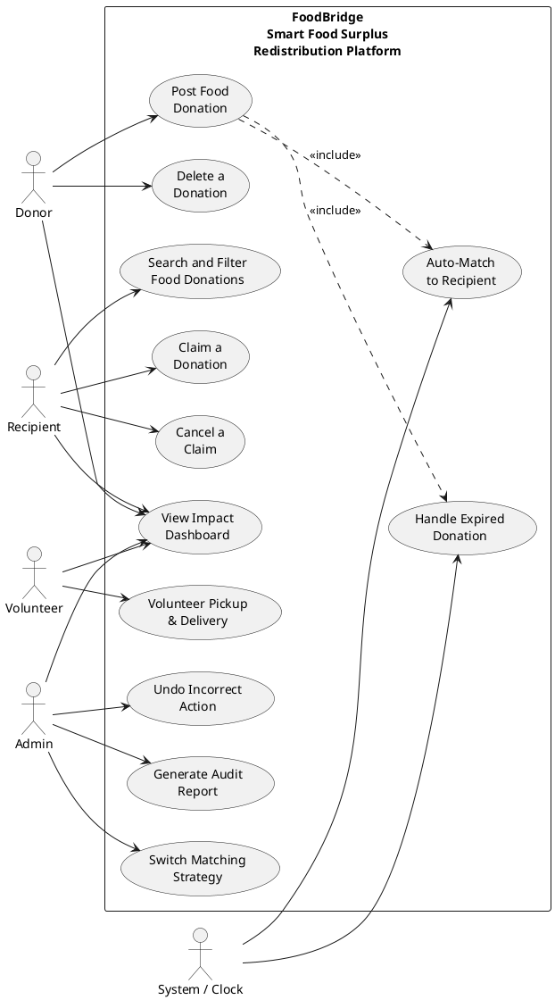

---

## g. Sequence Diagram Prompts (Detailed Design)

### What these prompts produce

These prompts produce **design-level sequence diagrams**, not black-box system sequence diagrams. Each diagram shows the actual collaborators from the project:

- **Presentation:** the JavaFX controller that receives the actor's action.
- **Business:** `DonationCoordinator`, commands, factories, strategies, state objects, and observers.
- **Domain:** `Donation`, `Donor`, `Recipient`, `Volunteer`.
- **Data:** `DonationRepository` and `UserRepository`.

Every diagram follows the corresponding use case and keeps the important extensions as `alt` branches or notes. They are intentionally drawn at a medium level of detail: enough to show the design patterns, but short enough to modify.

> **Implementation note:** the current UI controllers sometimes create commands directly (for example, `RecipientDashboardController.handleClaim()` and `VolunteerDashboardController.handlePickup()`). The diagrams model the intended business-layer flow through `DonationCoordinator`. If your code keeps the direct-UI wiring, remove `COORD` from that diagram and connect `UI` to `INV` directly; the rest of the message order stays the same.

### Notation used

| Element | PlantUML | Meaning |
|---|---|---|
| Actor | `actor Donor` | Human actor outside the system |
| Boundary | `boundary "PostDonationForm\nController" as UI` | JavaFX controller / view model |
| Control | `control "Donation\nCoordinator" as COORD` | Business service or design-pattern participant |
| Entity | `entity "Donation" as DONATION` | Domain object |
| Database | `database "Donation\nRepository" as DREPO` | Repository / data access |
| Synchronous call | `UI -> COORD : postDonation(params)` | Caller waits for the result |
| Return | `COORD --> UI : donationId` | Result or confirmation |
| Create | `COORD -> CMD ** : new ClaimDonationCommand(...)` | Creates a command or object |
| Self-call | `INV -> INV : history.addLast(cmd)` | Internal processing |
| Branch | `alt ... else ... end` | Success and failure paths |
| Optional | `opt ... end` | A step that may not happen |
| Loop | `loop ... end` | Iteration or polling |
| Note | `note right of ... ... end note` | Design hint; safe to delete |

### Prompt index

| UC | Use case | Key participants | Patterns exercised |
|---|---|---|---|
| UC-01 | Post Food Donation | UI, Coordinator, Factory, Verification Chain, repositories, observers | Factory Method, Chain of Responsibility, State, Observer |
| UC-02 | Delete a Donation | UI, Coordinator, repository, Donation, observers | Repository, Observer |
| UC-03 | View Impact Dashboard | UI, DashboardViewModel, repositories | Observer-fed ViewModel (read-only) |
| UC-04 | Claim a Donation | UI, Coordinator, Invoker, ClaimCommand, repository, Donation, State, observers | Command, State, Observer |
| UC-05 | Cancel a Claim | UI, Coordinator, Invoker, CancelCommand, repository, Donation, State, observers | Command, State, Observer |
| UC-06 | Search and Filter Food Donations | UI, DonationListViewModel, repository, Donation | ViewModel, filtering |
| UC-07 | Volunteer Pickup and Delivery | UI, Coordinator, Invoker, commands, repositories, Donation, State, Volunteer, Recipient, observers | Command, State, Observer |
| UC-08 | Switch Matching Strategy | UI, MatchingEngine, MatchingStrategy | Strategy |
| UC-09 | Undo Incorrect Action | UI, Coordinator, Invoker, Command, repository, Donation, State, AuditTrail, observers | Command, State |
| UC-10 | Generate Audit Report | UI, Coordinator, AuditTrail, AuditLogViewModel | Read-only query / audit trail |
| UC-11 | Auto-Match to Recipient | Coordinator, MatchingEngine, Strategy, UserRepository, Recipient, observers | Strategy, Observer |
| UC-12 | Handle Expired Donation | ExpiryWatcher, repository, Donation, State, Coordinator, observers | Observer, State |

### Base template

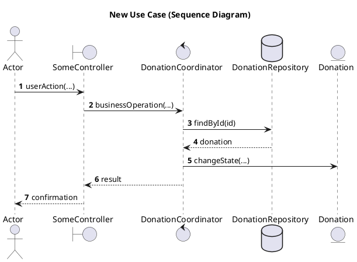

Copy this block and add only the collaborators needed for the use case. Delete arrows that do not apply.

---

### UC-01 - Post Food Donation

**Prompt:** Draw a detailed sequence diagram for a Donor posting surplus food. Show the controller, `DonationCoordinator`, `DonationFactory`, the verification chain, `Donation`, the repositories, and the observer notification. Include an `alt` branch for failed verification.

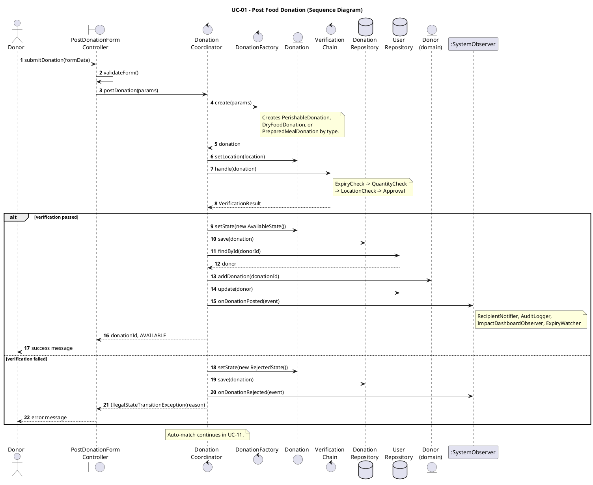

**Domain notes:** `DonationFactory` hides the three `Donation` subclasses; the `VerificationHandler` chain runs Expiry -> Quantity -> Location -> Approval; `Donation.setState(...)` delegates to the State pattern.

---

### UC-02 - Delete a Donation

**Prompt:** Draw a detailed sequence diagram for a Donor deleting one of their own donations. Show the controller, `DonationCoordinator`, `DonationRepository`, `Donation`, the ownership/status guard, and the observer notification. Include an `alt` branch for a donation that cannot be deleted.

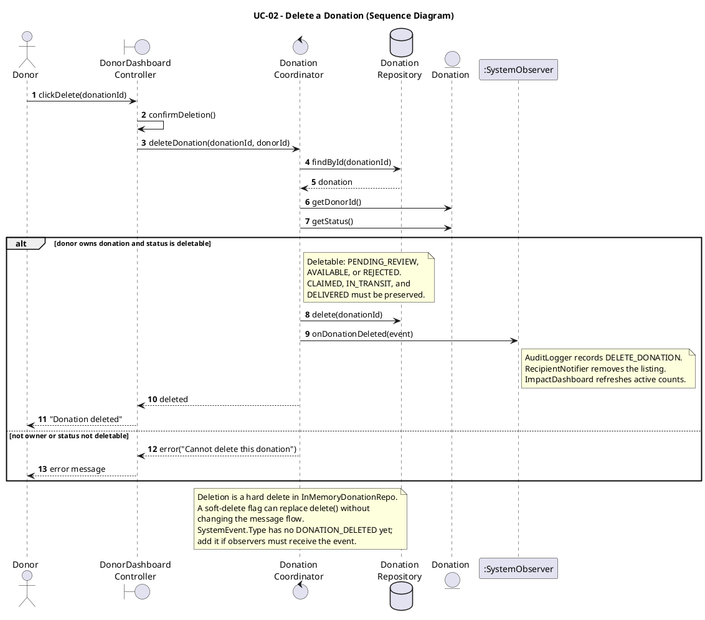

**Domain notes:** ownership is checked with `Donation.getDonorId()` and the state guard uses `Donation.getStatus()`. `DonationRepository.delete(UUID)` is the existing removal operation; no `DeleteDonationCommand` exists yet, so the coordinator calls the repository directly.

---

### UC-03 - View Impact Dashboard

**Prompt:** Draw a read-only sequence diagram for viewing the impact dashboard. Show the controller, `DashboardViewModel`, both repositories, and the read-only metric/top-list queries. Add an `alt` for no completed transactions.

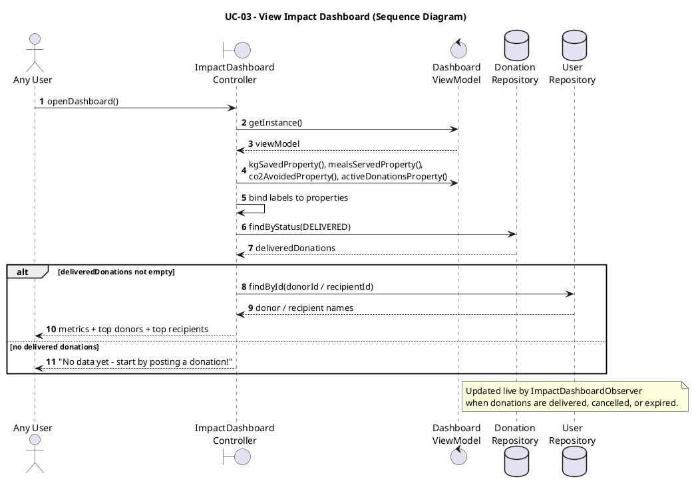

**Domain notes:** the dashboard is read-only. `DashboardViewModel` is updated by `ImpactDashboardObserver`; the controller only binds labels and builds the top-donor/top-recipient lists from delivered donations.

---

### UC-04 - Claim a Donation

**Prompt:** Draw a detailed sequence diagram for a Recipient claiming a donation. Show the controller, coordinator, `CommandInvoker`, `ClaimDonationCommand`, repository, `Donation`, `DonationState`, and observer notification. Add a note for the invalid-state extension.

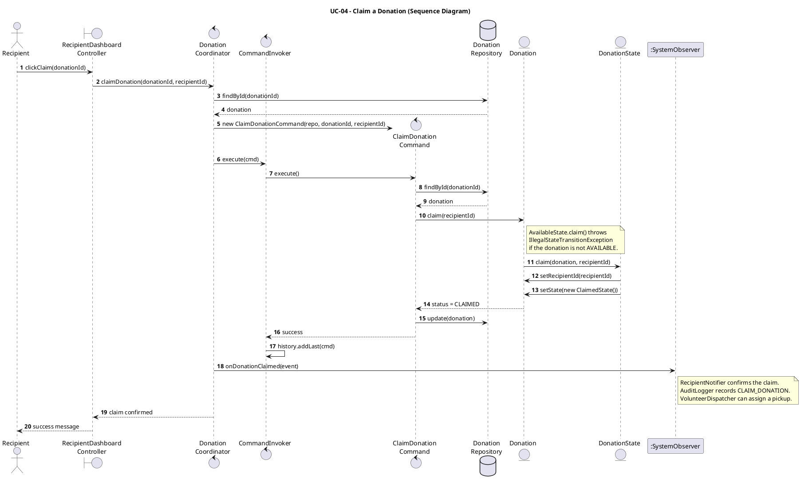

**Domain notes:** `ClaimDonationCommand` captures the recipient and donation IDs; `CommandInvoker` stores it for undo; `AvailableState.claim()` sets the recipient and swaps to `ClaimedState`.

---

### UC-05 - Cancel a Claim

**Prompt:** Draw a detailed sequence diagram for a Recipient cancelling a claim. Show the command flow, the `DonationState` transition from `CLAIMED` to `AVAILABLE`, and the observer notification. Include an `alt` for a donation already in transit or delivered.

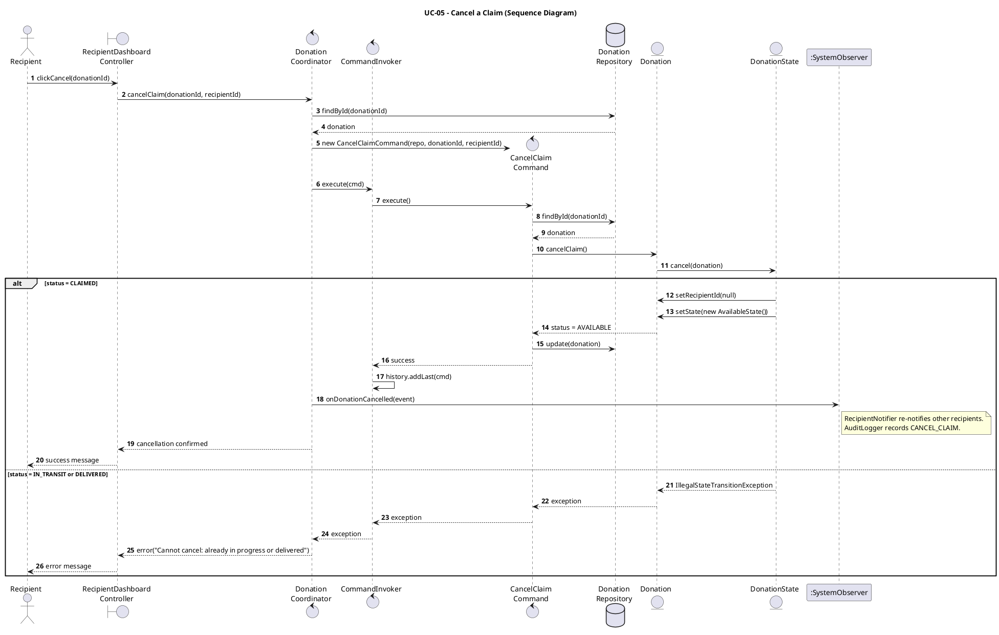

**Domain notes:** `ClaimedState.cancel()` clears `recipientId` and installs `AvailableState`. `CancelClaimCommand.undo()` can re-claim the donation if the previous status was `CLAIMED`.

---

### UC-06 - Search and Filter Food Donations

**Prompt:** Draw a sequence diagram for a Recipient searching and filtering available donations. Show the controller, `DonationListViewModel` filters, `DonationRepository`, and `Donation`. Include a loop over the candidates and an `alt` for no matches.

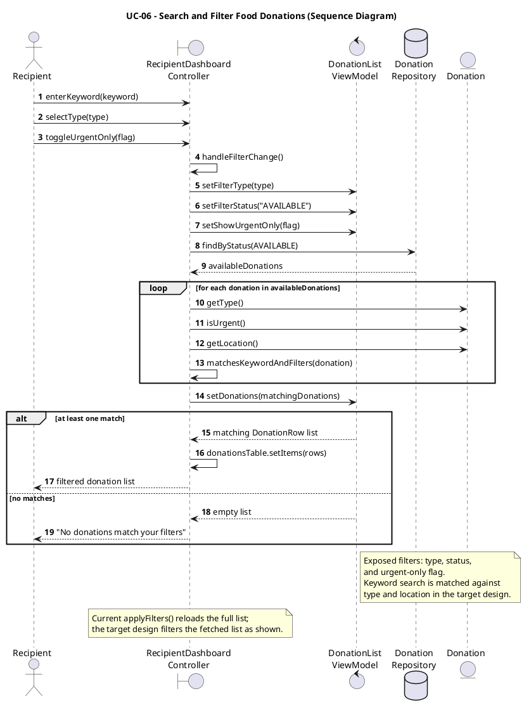

**Domain notes:** `DonationListViewModel` already exposes `filterType`, `filterStatus`, and `showUrgentOnly` properties. The controller owns the query and filtering loop; `DonationRow` supplies the table values. Add a text field bound to the keyword if full-text search is required.

---

### UC-07 - Volunteer Pickup and Delivery

**Prompt:** Draw one detailed sequence diagram with a pickup phase and a delivery phase. Show the volunteer controller, coordinator, commands, repositories, `Donation`, state transitions, `Volunteer`, `Recipient`, and observer notifications. Mark pickup as `CLAIMED` -> `IN_TRANSIT` and delivery as `IN_TRANSIT` -> `DELIVERED`.

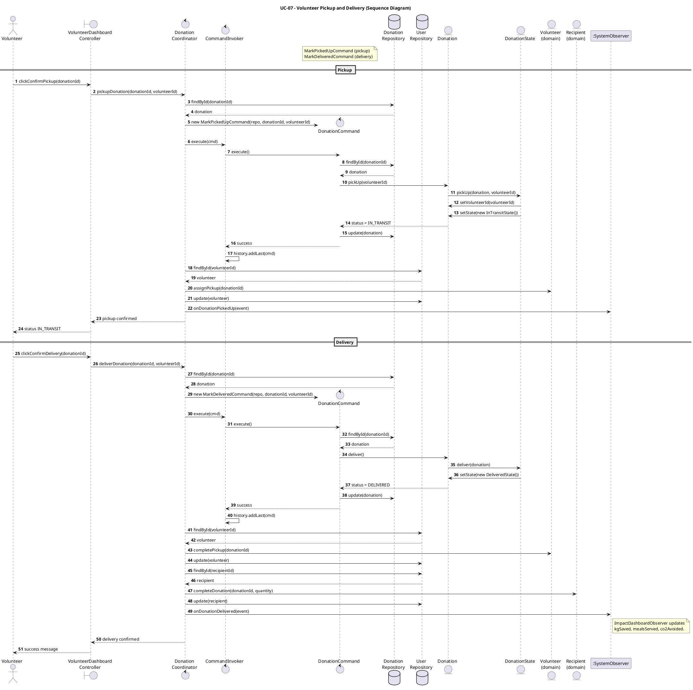

**Domain notes:** `MarkPickedUpCommand` and `MarkDeliveredCommand` are both `DonationCommand`s. The state classes enforce the legal transitions; `Volunteer.assignPickup()` and `Recipient.completeDonation()` keep the domain counters in sync.

---

### UC-08 - Switch Matching Strategy

**Prompt:** Draw a sequence diagram for switching the matching strategy. Show the controller, `MatchingEngine`, and `MatchingStrategy`. Include the three concrete strategy names, the runtime `setStrategy` call, and an `alt` for an already-active or invalid choice.

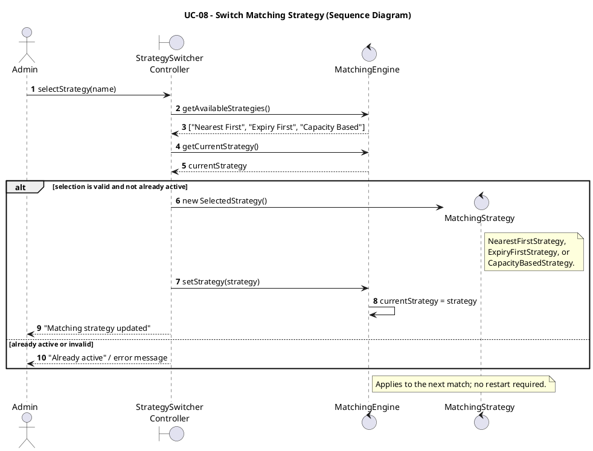

**Domain notes:** all strategies implement `MatchingStrategy.findBestMatch(...)` and `getName()`. `MatchingEngine` holds the current strategy, so switching is a single reference replacement.

---

### UC-09 - Undo Incorrect Action

**Prompt:** Draw a sequence diagram for undoing the last action. Show the audit controller, coordinator, `CommandInvoker`, the last `DonationCommand`, repository, `Donation`, `DonationState`, `AuditTrail`, and observers. Include an `alt` for an empty history and a note for terminal commands.

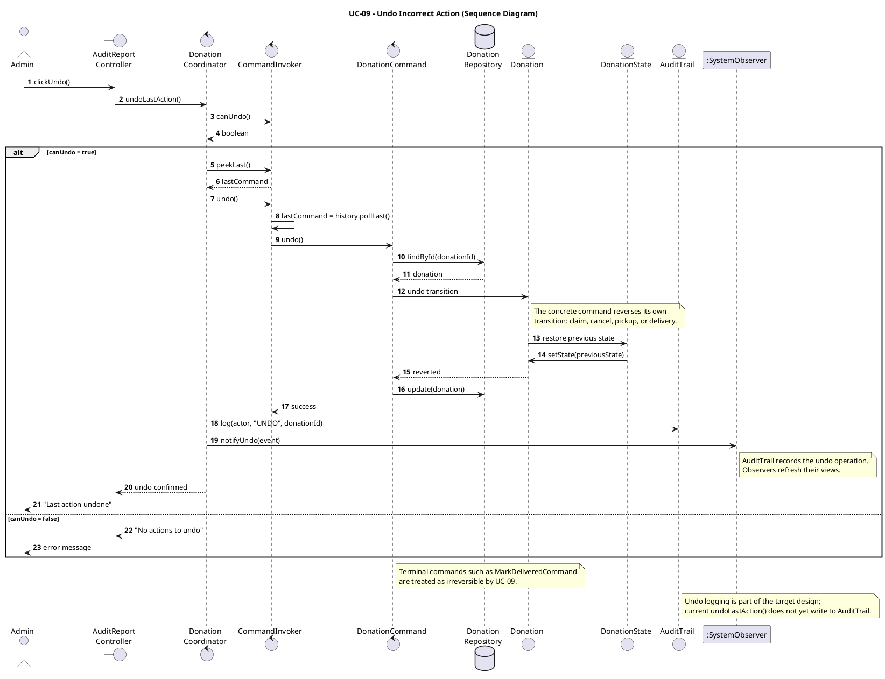

**Domain notes:** each concrete command implements `undo()` to reverse its own state transition. `CommandInvoker` uses a `Deque<DonationCommand>` history and `peekLast()` / `pollLast()` to expose and remove the last command.

---

### UC-10 - Generate Audit Report

**Prompt:** Draw a read-only sequence diagram for generating an audit report. Show the audit controller, coordinator, `AuditTrail`, and `AuditLogViewModel`. Include date/actor filtering and an `alt` for no records.

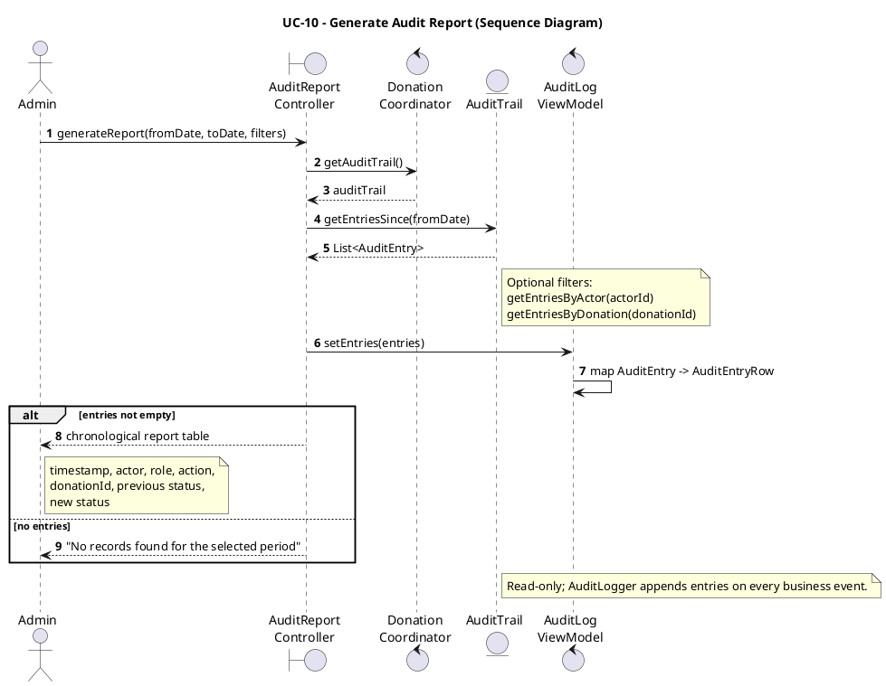

**Domain notes:** `AuditTrail.AuditEntry` is an immutable record; `AuditLogViewModel` maps each entry to an `AuditEntryRow` for the JavaFX table. No domain state is changed.

---

### UC-11 - Auto-Match to Recipient

**Prompt:** Draw a detailed sequence diagram for automatic matching. Show `DonationCoordinator`, `MatchingEngine`, the active `MatchingStrategy`, `UserRepository`, `Recipient`, `Donation`, and the observer notification. Include an `alt` for no eligible recipient and a reference to the UC-04 claim flow.

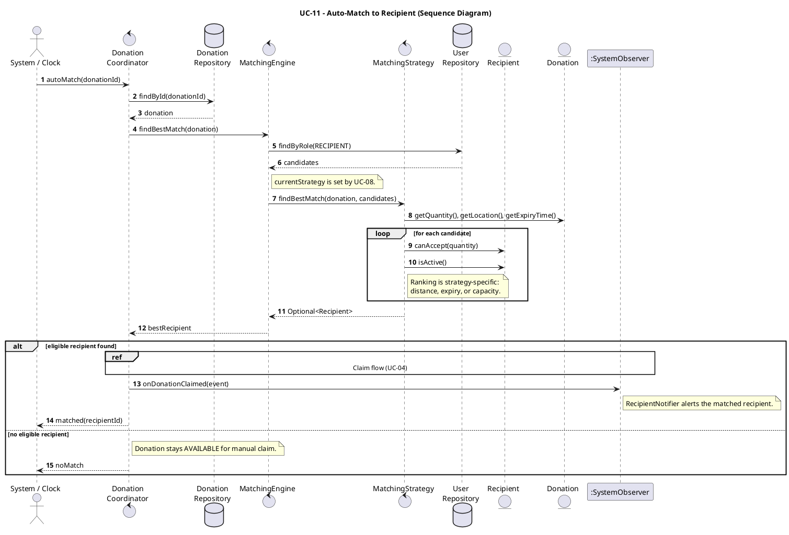

**Domain notes:** `MatchingEngine` reads the active `MatchingStrategy`, loads recipients through `UserRepository.findByRole(RECIPIENT)`, and delegates ranking. `NearestFirstStrategy`, `ExpiryFirstStrategy`, and `CapacityBasedStrategy` are interchangeable.

---

### UC-12 - Handle Expired Donation

**Prompt:** Draw a time-triggered sequence diagram for expiry handling. Show `ExpiryWatcher`, the repository, `Donation`, the state transition to `EXPIRED`, and the observer notification. Use a `loop` for polling and an `alt` for expired versus still-fresh donations.

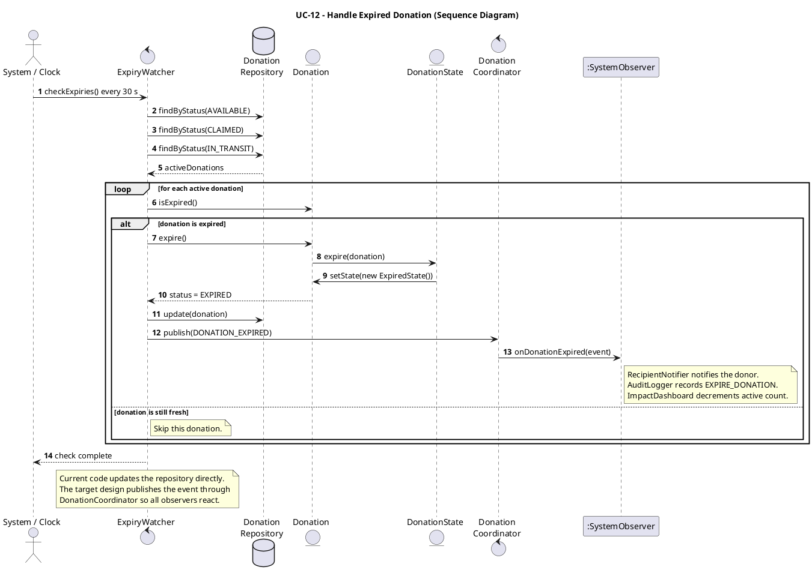

**Domain notes:** `ExpiryWatcher` is a scheduled `SystemObserver`; `Donation.isExpired()` compares the domain expiry time with the clock; `ExpiredState` is terminal.

---

## h. Customizing & Rendering the Sequence Diagrams

### Mapping diagram elements to the code

| Diagram element | Source package / class |
|---|---|
| UI controllers | `com.waslataam.ui.controllers` (`PostDonationFormController`, `DonorDashboardController`, `RecipientDashboardController`, `VolunteerDashboardController`, `ImpactDashboardController`, `StrategySwitcherController`, `AuditReportController`) |
| View models | `com.waslataam.viewmodel` (`DonationListViewModel`, `DashboardViewModel`, `AuditLogViewModel`) |
| Coordinator | `com.waslataam.coordination.DonationCoordinator` |
| Commands | `com.waslataam.command` (`CommandInvoker`, `ClaimDonationCommand`, `CancelClaimCommand`, `MarkPickedUpCommand`, `MarkDeliveredCommand`, `AuditTrail`) |
| State | `com.waslataam.state` (`AvailableState`, `ClaimedState`, `InTransitState`, `DeliveredState`, `ExpiredState`, `RejectedState`) |
| Strategy | `com.waslataam.strategy` (`MatchingEngine`, `NearestFirstStrategy`, `ExpiryFirstStrategy`, `CapacityBasedStrategy`) |
| Chain | `com.waslataam.chain` (`ExpiryCheckHandler`, `QuantityCheckHandler`, `LocationCheckHandler`, `ApprovalHandler`) |
| Observers | `com.waslataam.observer` (`RecipientNotifier`, `AuditLogger`, `ImpactDashboardObserver`, `ExpiryWatcher`) |
| Repositories | `com.waslataam.repository` (`DonationRepository`, `UserRepository`) |
| Domain model | `com.waslataam.domain` (`Donation`, `Donor`, `Recipient`, `Volunteer`, `DonationState`, `Location`) |

### Common changes

| Goal | Change |
|---|---|
| Rename a class | Update the `participant`/`control`/`entity` declaration; aliases keep the arrows stable |
| Add a parameter | Edit the text after `:` on the arrow; keep names short |
| Remove a layer | Delete the lifeline and reconnect the neighboring messages |
| Collapse the observers | Keep one `:SystemObserver` lifeline and list the concrete observers in a note |
| Expand the observers | Replace `OBS` with `RecipientNotifier`, `AuditLogger`, `ImpactDashboardObserver`, and `ExpiryWatcher` lifelines |
| Expand the state | Replace `DonationState` with the concrete state used at that point (`AvailableState`, `ClaimedState`, etc.) |
| Add an alternate flow | Wrap it in `alt condition ... else ... end` |
| Show an optional step | Use `opt condition ... end` |
| Reference another use case | Use `ref over COORD, OBS : Claim flow (UC-04)` |
| Simplify to a black-box view | Keep only the actor and a single `:System` lifeline; replace internal calls with actor-to-system messages |
| Reduce width | Delete unused repositories/domain lifelines and move secondary details into notes |

### Rendering

Paste each block into one of these:

- the PlantUML extension for VS Code or IntelliJ,
- an online renderer such as `plantuml.com/plantuml`,
- the PlantUML CLI: `java -jar plantuml.jar UC-01-post-food-donation.puml`.

Each block is independent: it starts with `@startuml` and ends with `@enduml`, so you can save each one as its own `.puml` file. Suggested file names follow the pattern `UC-01-post-food-donation.puml`, `UC-02-delete-donation.puml`, and so on through `UC-12-handle-expired-donation.puml`.
